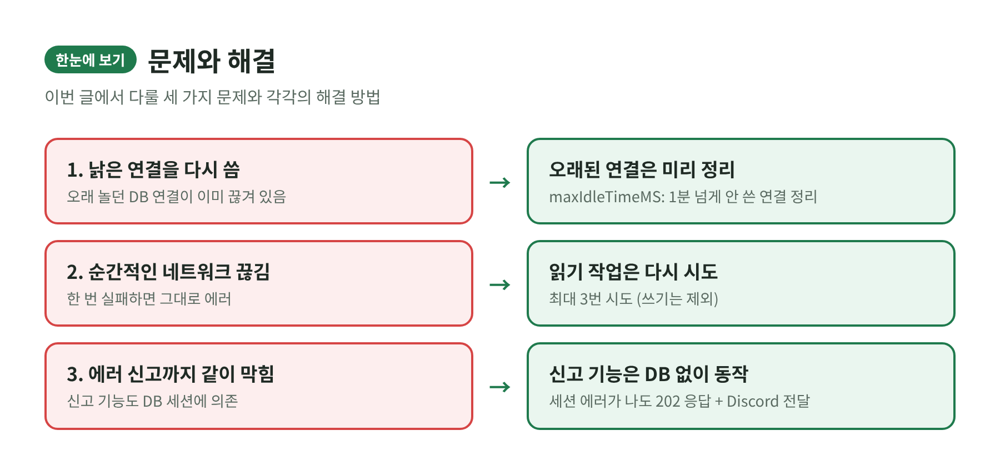
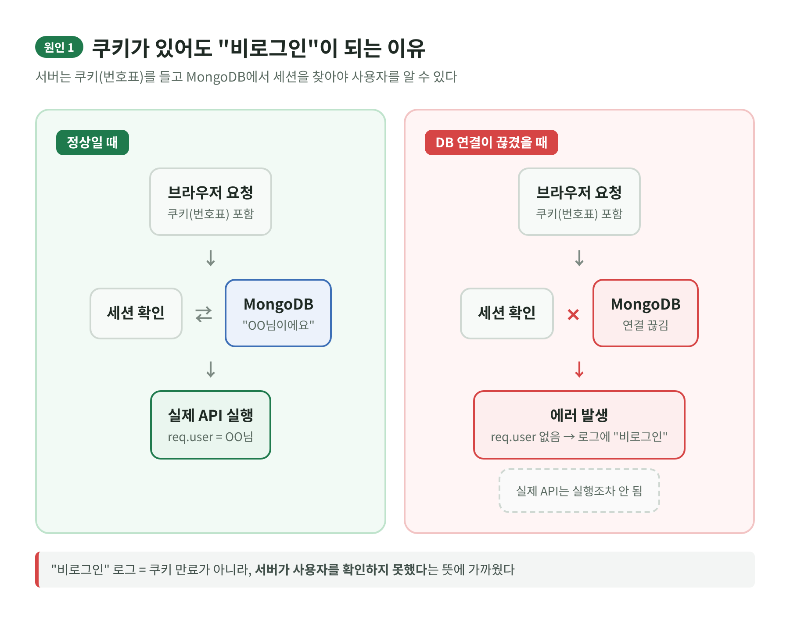
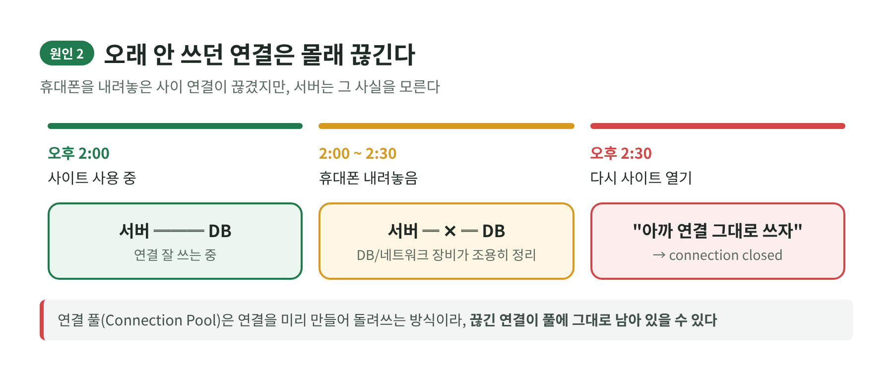
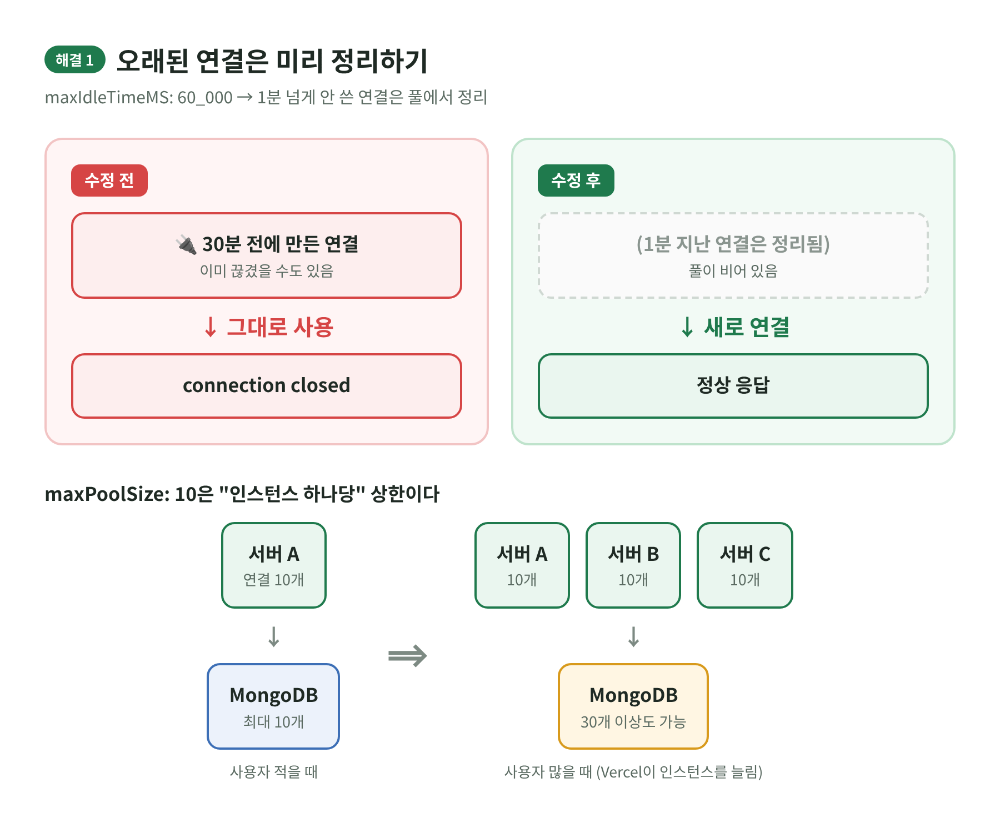
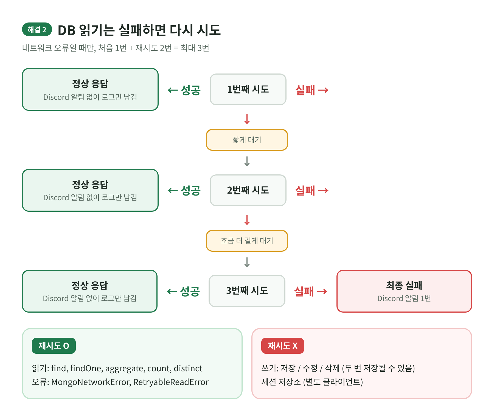
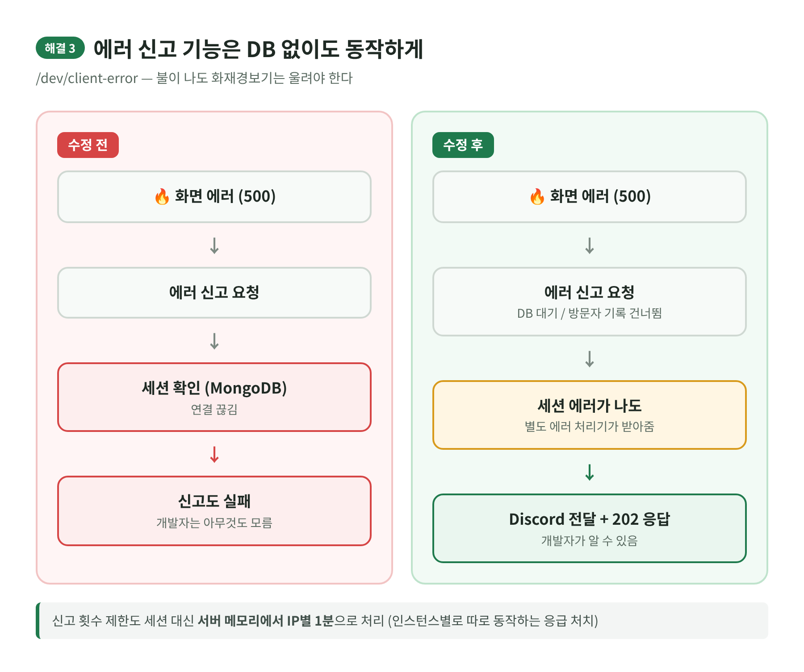

# [축구모임 홈페이지개발] MongoDB connection closed / connection timed out



### ⚽ **개요**

홈페이지를 운영하면서 휴대폰으로 사이트를 열어둔 채 한동안 다른 앱을 쓰다가 다시 돌아오면, 가끔 화면이 제대로 뜨지 않는 일이 있었다.

서버 로그를 확인해보니 아래와 같은 에러가 반복해서 찍혀 있었다.

```
connection 1 to <MongoDB host>:27017 closed
connection timed out
```

말 그대로 **DB와 연결되어 있는 줄 알았는데 이미 끊겨 있었다**는 뜻이다.

이상한 점이 하나 더 있었다. 분명 로그인한 상태였는데 에러 로그에는 사용자가 **"비로그인"** 으로 기록되는 경우가 있었다. 관리 페이지(/management) 하나만의 문제도 아니었고, 여러 API에서 비슷하게 나타났다.

| 증상 | 내용 |
|---|---|
| 언제 | 휴대폰을 백그라운드에 오래 뒀다가 다시 사이트를 열 때 |
| 에러 | connection closed / connection timed out |
| 이상한 점 | 로그인 상태인데 로그에는 "비로그인" |
| 범위 | 특정 페이지가 아니라 여러 API |

### ⚽ **원인 분석**

**1. 로그인 쿠키가 있다고 서버가 나를 알아보는 건 아니다**

로그인을 하면 브라우저에 쿠키가 저장되는데, 이 쿠키는 일종의 **번호표**일 뿐이다. 서버는 요청이 올 때마다 이 번호표를 들고 MongoDB에 저장된 세션 정보를 찾아본 뒤에야 "이 사람이구나" 하고 사용자를 확인한다. (express-session의 저장소로 MongoDB를 쓰고, Passport가 사용자를 복원하는 구조다.)

그리고 이 세션 확인 과정은 **모든 API보다 먼저** 실행된다.



여기서 MongoDB 연결이 끊겨 있으면 세션을 읽지 못하고, 실제 API 코드에 도달하기도 전에 요청이 실패한다. 사용자를 확인하지 못했으니 로그에는 "비로그인"으로 남는다.

즉 **"비로그인" 로그가 쿠키가 만료되었다는 뜻은 아니었던 것이다.** 서버가 확인을 못 했다는 뜻에 더 가까웠다.

**2. 오래 안 쓰던 연결은 몰래 끊길 수 있다**

서버는 DB에 매번 새로 연결하지 않고, 미리 만들어 둔 연결을 돌려쓰는 **연결 풀(Connection Pool)** 방식을 쓴다. 전화를 매번 새로 거는 대신 통화를 켜둔 채로 필요할 때 말하는 것과 비슷하다.

그런데 아무 말 없이 오래 켜두면 중간에 통화가 끊길 수 있다. MongoDB 서버나 중간 네트워크 장비가 오래 놀고 있는 연결을 정리해버리기 때문이다. 문제는 **서버가 이 사실을 모른다**는 것이다.



여기에 Vercel의 서버리스 특성도 영향을 줄 수 있다. Vercel은 요청이 없으면 실행이 멈췄다가 다시 깨어나기도 하고, 요청이 많아지면 서버(인스턴스)를 여러 개로 늘리기도 한다.

다만 로그에 찍힌 주소는 연결하려던 DB 주소일 뿐이라서, **이것만으로 Vercel이 원인이라고 단정할 수는 없었다.** DB 업체 쪽의 네트워크 제한이나 연결 수 한도도 같이 봐야 하는 부분이다.

**3. 에러 신고 기능까지 같이 막혔다**

브라우저에서 HTTP 500 에러가 나면 /dev/client-error로 에러를 신고하도록 만들어 두었었다. 그런데 이 경로도 세션 확인을 거쳤고, 게다가 마지막으로 신고한 시간을 세션(MongoDB)에 저장하고 있었다.

결국 **DB에 문제가 생기면 그 문제를 알려줄 신고 기능까지 같이 실패하는 구조**였던 것이다. 불이 나면 화재경보기도 같이 꺼지는 셈이었다.

### ⚽**해결 방법**

**1. 오래된 연결은 미리 정리하기 (database.js)**

```
const client = new MongoClient(url, {
  maxPoolSize: 10,
  maxIdleTimeMS: 60_000
});
```

| 옵션 | 의미 | 효과 |
|---|---|---|
| maxIdleTimeMS: 60_000 | 1분 넘게 안 쓴 연결은 풀에서 정리 | 끊겼을지도 모르는 낡은 연결 재사용 방지 |
| maxPoolSize: 10 | 서버 하나가 만들 수 있는 DB 연결 수 상한 | 연결이 과하게 늘어나는 것 방지 |



다만 maxPoolSize는 **인스턴스 하나당** 기준이라, Vercel이 인스턴스를 3개로 늘리면 전체 연결은 30개 이상이 될 수도 있다. 실제 트래픽과 DB 연결 수를 보면서 조정이 필요한 값이다.

**2. DB 읽기는 실패하면 잠깐 쉬었다 다시 시도하기 (server.js)**

네트워크가 순간적으로 끊긴 거라면 한 번 더 시도했을 때 성공하는 경우가 많다. 그래서 server.js에서 쓰는 **읽기 작업**(find, findOne, aggregate, count, distinct)에 재시도를 붙였다.



네트워크 오류(MongoNetworkError)이거나 드라이버가 재시도 가능한 읽기 오류(RetryableReadError)로 표시한 경우에만, **처음 1번 + 재시도 2번 = 최대 3번**까지 시도한다.

재시도 사이에는 점점 길어지는 대기 시간(지수형 대기)에 약간의 무작위 시간(지터)을 섞어서, 여러 요청이 한꺼번에 몰려 재시도하지 않도록 했다.

재시도 끝에 성공한 경우까지 매번 알림이 오면 시끄럽기 때문에, **Discord 알림은 모든 시도가 실패했을 때만 한 번** 보낸다. 대신 요청 ID, 시도별 DB 소요 시간, 대기 시간 등은 서버 로그에 남기도록 했다. 겸사겸사 DEV용 Discord 알림도 코드 블록 대신 제목, 본문, 색상, 시간이 들어간 임베드 형태로 바꿨다.

참고로 MongoDB 드라이버도 내부적으로 자체 재시도를 하기 때문에, 앱에서 3번 시도했다고 실제 네트워크 요청이 정확히 3번인 것은 아니다.

**3. 에러 신고 기능은 DB 없이도 동작하게 하기 (/dev/client-error)**



이 경로는 DB 준비 대기와 일일 접속자 기록을 건너뛰도록 했고, 세션 미들웨어에서 에러가 나더라도 **별도 에러 미들웨어가 받아서 원래 에러 내용을 보고한 뒤 202로 응답**하게 했다.

신고 횟수 제한도 세션 대신 서버 메모리에서 IP별 1분 제한으로 바꿨다. 다만 이건 인스턴스마다 따로 동작하는 방식이라 완벽한 제한은 아니고, 일종의 응급 처치에 가깝다.

DB 세션을 못 읽은 상태라면 여전히 "비로그인"으로 남을 수 있는데, 이때는 로그인 여부를 억지로 추측하지 않고 **원래 에러와 요청 경로를 우선 기록**하도록 했다.

### ⚽ **수정 전 vs 수정 후**

| 구분 | 수정 전 | 수정 후 |
|---|---|---|
| 오래된 연결 | 그대로 다시 사용 | 1분 넘으면 정리 |
| 연결 수 상한 | 따로 없음 | 인스턴스당 10개 |
| 읽기 실패 시 | 바로 에러 | 최대 3번 시도 |
| 쓰기 실패 시 | 바로 에러 | 바로 에러 (중복 저장 방지) |
| Discord 알림 | - | 최종 실패 시에만 1번 |
| 에러 신고 | DB 세션에 의존 | DB 없이도 202 응답 |

### ⚽ **배포 후 확인할 것**

로컬에서 문법 검사, 재시도 시뮬레이션(읽기는 회복되고 쓰기는 재실행되지 않는지), MongoDB 연결, /dev/client-error의 202 응답까지는 확인했다.

하지만 실제로 DB 연결을 강제로 끊거나 Vercel 함수가 잠들었다 깨어나는 상황은 로컬에서 재현하지 못했다. 그래서 **이번 수정이 실제로 에러를 얼마나 줄였는지는 배포 후에 지켜봐야 한다.**

| 순서 | 확인할 곳 | 확인할 내용 |
|---|---|---|
| 1 | 휴대폰 | 백그라운드에 한참 둔 뒤 첫 요청이 잘 되는지 |
| 2 | Vercel 로그 | 에러 시각의 함수 리전, 인스턴스 증가, 콜드 스타트 |
| 3 | MongoDB 업체 로그 | 연결 종료, 프라이머리 변경, 연결 수 한도, 네트워크 접근 제한 |
| 4 | 계속 발생하면 | DB 연결 수와 한도 비교, Vercel 아웃바운드 IP 정책과 리전 점검 |

아직 남은 숙제도 있다. DB가 진짜로 접속 불가능한 동안에는 어떤 수정을 해도 DB를 쓰는 API는 성공할 수 없다. 그리고 서버가 처음 켜질 때 DB 연결에 실패하면 해당 인스턴스의 dbReady Promise가 계속 실패 상태로 남을 수 있는데, 이 부분은 따로 재시도 설계가 필요하다.

처음에는 로그에 찍힌 "비로그인"만 보고 로그인 쪽 문제라고 생각했었는데, 알고 보니 세션을 읽는 DB 연결의 문제였다. **오래 놀고 있던 연결은 믿으면 안 된다는 것**, 그리고 **장애를 알려주는 기능은 장애가 나는 곳과 분리해둬야 한다는 것**도 이번에 알게 되었다.
